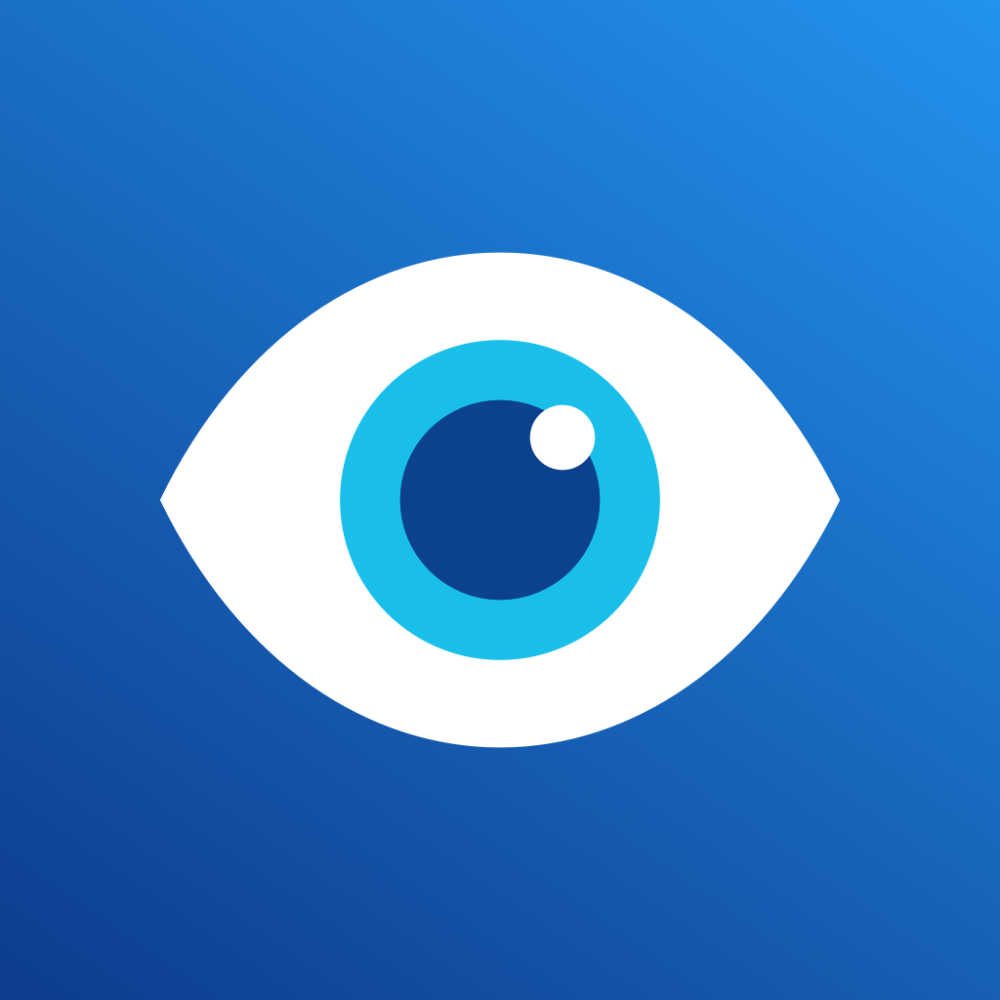

# 视界 VisionMeasure

**简体中文** · [English](README.en.md) · [下载 Release](https://github.com/chen-bliss/vision-measure/releases)



支持 iPhone 和 Mac 的原生屈光测量研究应用，不需要外接光学配件。

0.3.2版修复语音只能回答一轮的问题：每轮图案可作答时建立新的识别任务，每轮只提交一次，忽略旧任务回调；识别正常结束或短暂中断后自动重新接收，连续失败会提示重新开启。用户已在真实 iPhone 上反馈目前连续语音作答正常；这属于使用反馈，不是受控识别率测试。

0.3.1版修正内屏拿远时的校准误触发：设备重力姿态只作元数据，尺寸校准按实际显示几何判断；短暂视图挂载和一像素内舍入变化不清除校准。趣味页新增字体／图案大小滑杆，以及预处理PNG保存到文件；iPhone另有保存到相册（仅添加照片权限）。改变大小后会重新计算预处理，不直接拉伸旧图。

**当前状态：已实现可运行的研究原型及对照分析工具，尚未证明达到准确测量近视、散光并用于配镜的第三级目标。** 缺少真实受试者和专业验光对照数据时，软件测试不能代替临床证据。

## 现在可以使用的功能

- 分别记录左右眼，输入匿名编号，进行屏幕实际尺寸校准。
- 自动深度测距（兼容的 iPhone）、普通摄像头个人两点校准、人工实测距离三种方式。
- 普通摄像头缺少可靠距离、画面中断、姿态变化、范围超限时暂停采样；可切换人工流程。
- 根据屏幕真实分辨能力限制最近距离，保持条纹角宽和窗口视角一致。
- 随机左右条纹辨认：加粗练习、六个方向各两轮、远点两侧边界搜索。无法辨认练习图案时可明确结束，不输出度数。
- 从方向屈光数据拟合球镜、柱镜和轴位；缺失边界、方向不一致、重复性不足时不报告度数。
- 可选本机中文语音作答、Mac 左右方向键、协助者点击。
- 原始记录自动保存在本机，可导出 JSON；不保存人脸照片或录音。
- 导入专业验光 CSV，统计准确性、重复性、完成率、机型和测距方式分层。

## 打开 Mac 应用

从 [Release](https://github.com/chen-bliss/vision-measure/releases/tag/v0.3.2) 下载 `VisionMeasure-0.3.2-macOS-arm64.zip` 并解压，打开其中的“视界研究版.app”。当前预编译包面向 Apple 芯片 Mac，使用临时签名，尚未进行 Apple 公证或上架；系统可能要求在“隐私与安全性”中允许打开。Intel Mac 需自行构建，当前没有已验证的预编译包。

源码构建后，应用位于 `Build/视界研究版.app`。应用界面当前为中文，项目文档提供中英文。

1. 先阅读适用条件。本版先针对成年裸眼受试者；已知眼病、儿童、远视和混合散光不属于已实现的有效性范围。
2. 用尺子测量蓝线实际长度，输入厘米数。不要把输入值当作随意设置；屏幕缩放改变后重新校准。
3. 选择人工测距，或启动摄像头。普通摄像头需要两个实测距离，不能凭“检测到脸”直接获得准确厘米值。
4. 开始练习后，按提示改变眼睛与屏幕的距离。正式测试每位置16次判断，完整研究流程较长，可随时停止。
5. 同一位置的人工距离确认不按时间失效；每次移动、目标距离变化、切换测距方式、显示环境变化或离开前台后，需重新实测确认。手机远距离测试请使用语音或协助者操作，不能伸手点击而改变受测距离。
6. 在“记录”页查看或导出。**研究估计不是配镜处方。** 无法完成不等于零度，也不等于没有近视或散光。

## 趣味视觉实验

先校准屏幕尺寸，再进入“趣味”。填写已有验光处方中的近视/负柱镜散光度数和轴位，测量当前观看距离，选择文字、爱心或箭头并生成。可调处理强度，切换原图与预处理图；输入只保留在当前页面，不写入研究记录。可调整字体／图案大小后重新生成，并保存处理后的PNG到文件；iPhone也能主动保存到相册。相册自动缩放可能改变效果，需保持相同物理显示大小与观看距离。

这里使用简化模糊模型和有界逆滤波，不是光场显示，也不是实测眼睛的点扩散函数。详见 `Docs/Fun-vision-experiment.md`。

## 在 Xcode 打开 iPhone 工程

打开 `VisionMeasure.xcodeproj`，选择 `VisionMeasure` scheme 和 iPhone。

iPhone Duo 的准备和真机检查见 `Docs/iPhone-Duo-check.md`。0.2版按当前窗口/显示场景校准，内外屏分别处理；0.3.1仅按真实显示几何和界面轴向判断变化，重力姿态不再触发尺寸重校准。需要实际手机验证切屏、折叠及摄像头切换，不能把模拟器检查当作精度证据。

- 最低声明版本：iOS 16、macOS 13。实际兼容性仍需在对应系统和硬件上逐一验证。
- 模拟器可运行界面、人工测距和流程测试，不能验证真实摄像头、深度测距、麦克风、眼睛光学效果或物理尺寸。
- 真机安装需在 Signing & Capabilities 中选自己的 Apple 开发团队，然后由 Xcode 签名安装。
- 没有硬编码开发团队、远程地址、用户名或密码。
- 全部 Swift 界面与测量核心由 iPhone 和 Mac 共享。Xcode 使用原生应用、共享框架和界面测试目标；命令行构建使用同一套源码的 Swift Package，无第三方依赖。

重新生成工程：`python3 Tools/create_xcode_project.py`。

## 本机构建和核心测试

```sh
swift build
Tools/build_mac.sh
swift test
python3 -m unittest discover -s Tools -p 'test_*.py' -v
```

`swift test` 需要完整 Xcode 提供 XCTest；仅有 Command Line Tools 的 Mac 可编译应用，但可能无法运行 XCTest。

## 对照验证工具

先创建验光数据空表：

```sh
python3 Tools/validate_study.py --template Docs/reference-template.csv
```

把应用导出的 JSON 和对应的专业验光数据配对：

```sh
python3 Tools/validate_study.py session-1.json session-2.json \
  --references clinical-references.csv --out Build/validation
```

打开生成的 `report.html`。`report.json` 保留详细统计、排除原因、重复性及分层结果。CSV 每行通过 session_id 关联一次应用测量；列说明见 `Docs/Validation-plan.md`。

尚无真实数据时，验证状态为 `NOT_ESTABLISHED`；本机构建产物和研究数据不随仓库分发。

测距应在验光对照前独立核验：

```sh
python3 Tools/validate_distance.py --template Docs/distance-reference-template.csv
python3 Tools/validate_distance.py collected-distance.csv --out Build/distance-validation
```

该工具比较应用读数与独立尺子实测值，将距离误差换算为可能引入的光焦度差，保留无法读数的情况，并排除用于个人校准的位置。采集方法和列说明见 `Docs/Distance-check.md`。当前尚无独立真实测距数据。

验证工具不会把同一个人的双眼和多次测量当成多个独立受试者，也不会从重复记录中挑选误差最小的一次。模拟数据始终标为模拟，不能满足真实数据门槛。工具仍需人工核实数据来源、研究同意、专业验光流程和样本代表性。

## 模拟实验

```sh
swift run RefractionBench Build/synthetic-benchmark
python3 Tools/validate_study.py Build/synthetic-benchmark/SYNTHETIC-sessions.json \
  --references Build/synthetic-benchmark/SYNTHETIC-references.csv \
  --out Build/validation-synthetic
```

模拟器独立设定球镜、柱镜、轴位，再产生作答。含理想观察者、随机辨认噪声、持续调节导致整体偏差三个场景。模拟数据只检验计算流程和失败处理，不代表真实人眼表现。特别是“系统偏差”场景，即使结果可重复，仍可偏离真值；详见 `Docs/Validation-plan.md`。

## 代码结构

- `Sources/RefractionCore`：单位、距离校验、个人摄像头校准、边界搜索和规则散光拟合。
- `Sources/VisionMeasure`：SwiftUI 界面、摄像头、本机语音、原始记录与导出。
- `Sources/RefractionBench`：独立模拟观察者与压力测试。
- `Tests/RefractionCoreTests`：已知光学参数、符号与轴位、缺失边界、距离失效等测试。
- `UITests`：iPhone 界面、错误输入、距离阻断、停止测试不出结果的流程检查。
- `Tools/validate_study.py`：无第三方依赖的验光对照分析。
- `Tools/validate_distance.py`：独立实测距离核验，含失败记录、未用于校准的位置及参考误差分析。
- `Docs/Validation-plan.md`：通向第三级的验证方案和当前局限。

研究记录位于系统 Application Support 中的 `VisionMeasure` 目录；沙盒版本位于应用容器内。删除应用通常不会自动删除所有记录。请通过应用导出需要保留的记录。

## 当前发布检查

0.3.2（build 7）：47项核心检查通过，含9项语音路由；人工距离界面流程复查通过；真实手机安装与版本读回成功，用户随后反馈连续语音正常。首轮界面检查的键盘超时及后续复查均记录在[检查摘要](Docs/Verification-summary.md)中。原始本机诊断日志含设备标识和开发环境路径，未上传到仓库；研究数据、签名证书、账户凭据、构建缓存也不随仓库发布。
